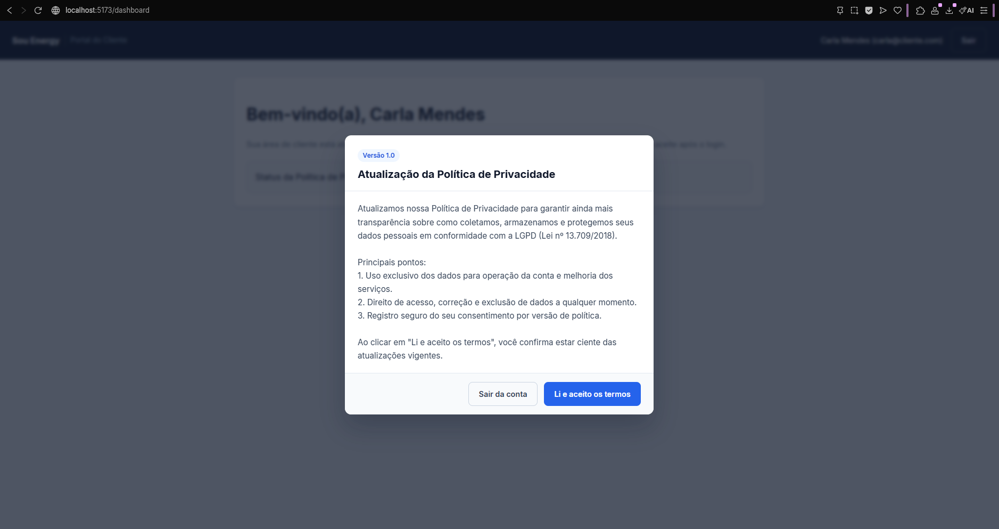
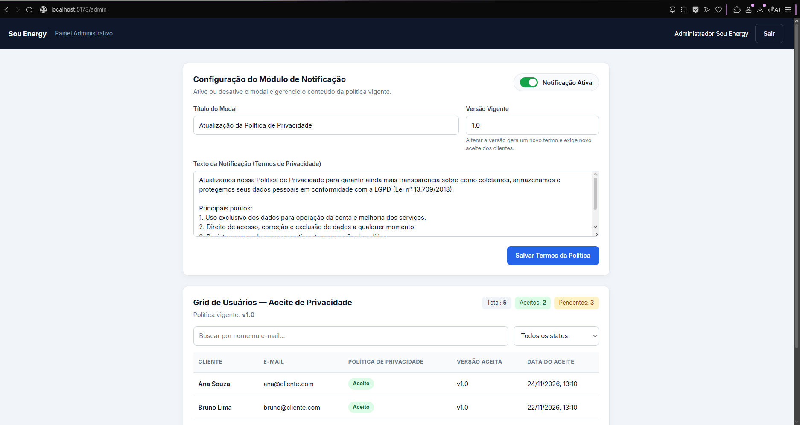
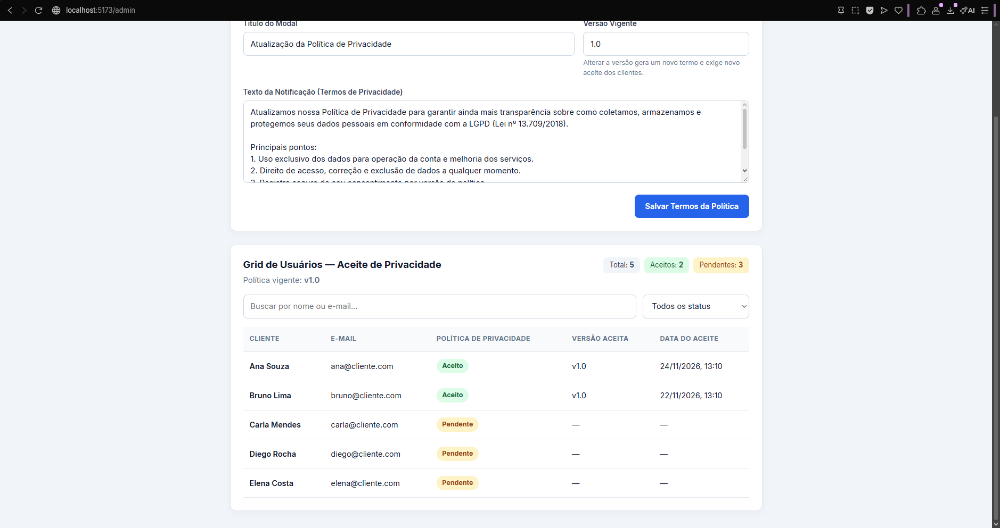
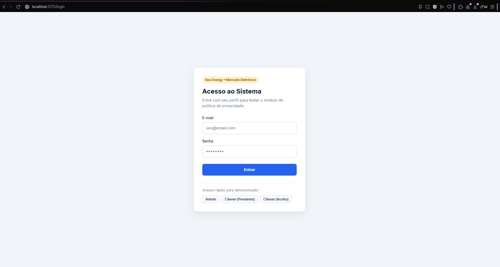
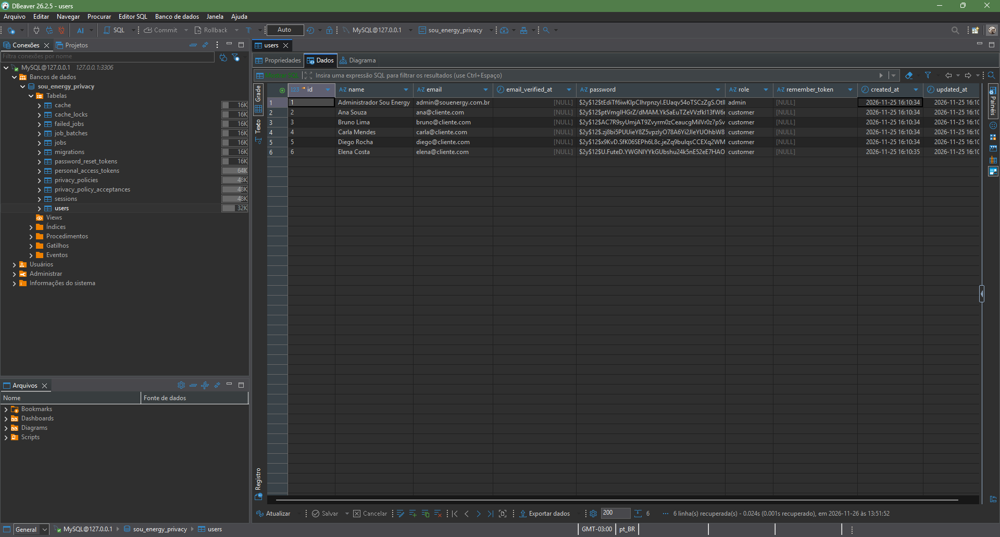
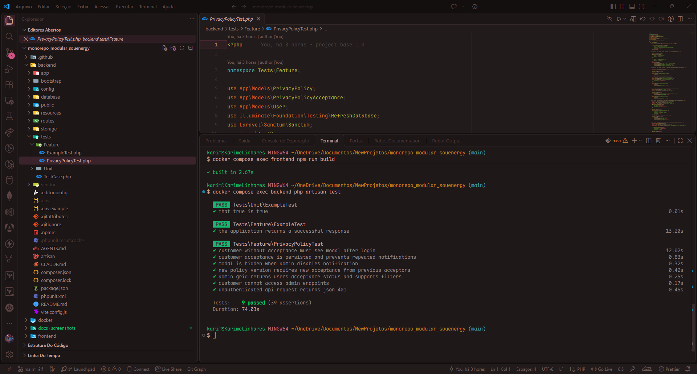

# Módulo de Notificação de Política de Privacidade — Sou Energy

Solução desenvolvida para o Teste Técnico de Desenvolvedor do Time Mercado Eletrônico. A aplicação implementa um módulo completo para notificar usuários sobre atualizações na Política de Privacidade após o login, persistir o aceite por versão e disponibilizar no painel administrativo o controle de exibição, edição dos termos e grid de acompanhamento de aceites.

---

## 1. Concepção e Implementação da Funcionalidade

O objetivo central é garantir que usuários autenticados visualizem e aceitem a versão vigente da Política de Privacidade sem receber notificações repetidas após a confirmação, enquanto administradores controlam a ativação do módulo e auditam o status de aceite dos clientes.

### Decisões de Concepção

- **Versionamento de Políticas (em vez de flag booleana no usuário):** Em vez de adicionar apenas uma coluna `accepted_privacy` na tabela `users`, os termos foram modelados na tabela `privacy_policies` e os registros de consentimento na tabela relacional `privacy_policy_acceptances`. Isso permite publicar novas versões no futuro (ex.: `1.0` → `2.0`), exigindo novo aceite automaticamente sem perder o histórico de auditoria (data/hora e IP do aceite).
- **Separação entre Vigência (`is_current`) e Exibição (`is_enabled`):** Permite que o administrador desative temporariamente a exibição do modal sem perder a referência de qual versão da política está vigente.
- **Desacoplamento em Módulo:** No backend, a regra de negócio está centralizada em `PrivacyPolicyService`; no frontend, os componentes, serviços de API e composables ficam encapsulados em `frontend/src/modules/privacy-policy/`.

---

## 2. Tecnologias Utilizadas

| Camada                  | Tecnologias                                           |
| :---------------------- | :---------------------------------------------------- |
| **Backend**             | PHP 8.3, Laravel, Laravel Sanctum (API RESTful)       |
| **Frontend**            | Vue.js 3 (Composition API), Vite, Vue Router, Axios   |
| **Banco de Dados**      | MySQL 8.0 (produção/dev) e SQLite em memória (testes) |
| **Infraestrutura & CI** | Docker, Docker Compose, PHPUnit, GitHub Actions       |

---

## 3. Estrutura do Código e Arquitetura

O projeto segue uma arquitetura de **monorepo desacoplado** (API RESTful + SPA):

```text
sou-energy-privacy-module/
├── .github/workflows/
│   └── ci.yml                          # Pipeline de CI (PHPUnit + Build Vue)
├── docker/php/Dockerfile               # Imagem PHP 8.3 + extensões + Composer
├── docker-compose.yml                  # Orquestração MySQL, Backend e Frontend
├── backend/                            # API RESTful em Laravel
│   ├── app/
│   │   ├── Http/
│   │   │   ├── Controllers/Api/        # Auth, Fluxo do Cliente e Painel Admin
│   │   │   ├── Middleware/             # EnsureUserIsAdmin (controle de acesso)
│   │   │   └── Requests/               # FormRequests para validação de payloads
│   │   ├── Models/                     # User, PrivacyPolicy, PrivacyPolicyAcceptance
│   │   └── Services/
│   │       └── PrivacyPolicyService.php # Camada de regras de negócio
│   ├── database/
│   │   ├── migrations/                 # Estrutura relacional e índices únicos
│   │   └── seeders/                    # Carga inicial de política e contas de teste
│   └── tests/Feature/
│       └── PrivacyPolicyTest.php       # Suíte de testes de integração
└── frontend/                           # SPA em Vue 3
    └── src/
        ├── modules/privacy-policy/     # Módulo isolado e reutilizável
        │   ├── components/             # PrivacyPolicyModal e PrivacyPolicyAdminConfig
        │   ├── composables/            # usePrivacyPolicy (estado reativo do modal)
        │   └── services/               # privacyPolicyApi (chamadas REST)
        ├── router/                     # Guards de autenticação e perfil admin
        ├── services/api.js             # Instância Axios com interceptors Bearer/401
        ├── stores/auth.js              # Gerenciamento de sessão
        └── views/                      # Login, Portal do Cliente e Grid Admin
```

### Destaques Arquiteturais

- **Integridade no Banco:** Índice único composto `unique(['user_id', 'privacy_policy_id'])` impedindo aceites duplicados mesmo em requisições simultâneas.
- **Prevenção de Consultas N+1:** A listagem da grid administrativa utiliza _Eager Loading_ filtrado pela política vigente (`with(['privacyAcceptances' => ...])`).
- **Tratamento de Respostas API:** O `bootstrap/app.php` garante retorno padronizado em JSON (`401 Unauthenticated`) em todas as rotas `/api/*`, evitando redirecionamentos HTML indevidos.
- **Extensibilidade:** A estrutura permite adicionar facilmente múltiplos tipos de termos (ex.: Termos de Uso, Cookies), histórico visual de versões aceitas por usuário ou exportação CSV da grid administrativa sem refatorar a base existente.

---

## 4. Instalação e Configuração

### Pré-requisitos

- [Docker](https://www.docker.com/) e Docker Compose instalados.

### Passo a Passo

1. **Clone o repositório:**

   ```bash
   git clone [https://github.com/](https://github.com/)<SEU_USUARIO>/<SEU_REPOSITORIO>.git
   cd <SEU_REPOSITORIO>
   ```

2. **Configure as variáveis de ambiente:**

   ```bash
   cp backend/.env.example backend/.env
   cp frontend/.env.example frontend/.env
   ```

3. **Suba os containers (MySQL, Backend e Frontend):**

   ```bash
   docker compose up -d --build
   ```

4. **Instale as dependências e inicialize o backend:**

   ```bash
   docker compose exec backend composer install
   docker compose exec backend php artisan key:generate
   docker compose exec backend php artisan migrate --seed
   ```

5. **Instale as dependências do frontend (caso o `node_modules` ainda não exista):**

   ```bash
   docker compose exec frontend npm install
   docker compose restart frontend
   ```

6. **Acesse a aplicação:**
   - **Frontend (Vue.js):** `http://localhost:5173`
   - **Backend (API Laravel):** `http://localhost:8000`

### Credenciais de Demonstração (Seeder)

| Perfil                 | E-mail                   | Senha        | Estado Inicial na v1.0   |
| :--------------------- | :----------------------- | :----------- | :----------------------- |
| **Administrador**      | `admin@souenergy.com.br` | `admin123`   | Acesso ao painel e grid  |
| **Cliente (Pendente)** | `carla@cliente.com`      | `cliente123` | Modal exibido após login |
| **Cliente (Pendente)** | `diego@cliente.com`      | `cliente123` | Modal exibido após login |
| **Cliente (Pendente)** | `elena@cliente.com`      | `cliente123` | Modal exibido após login |
| **Cliente (Aceito)**   | `ana@cliente.com`        | `cliente123` | Aceite já registrado     |
| **Cliente (Aceito)**   | `bruno@cliente.com`      | `cliente123` | Aceite já registrado     |

_(A tela de login também oferece botões de preenchimento rápido para facilitar a avaliação.)_

---

## 5. Principais Endpoints da API

| Método | Endpoint                     | Acesso      | Descrição                                                                                          |
| :----- | :--------------------------- | :---------- | :------------------------------------------------------------------------------------------------- |
| `POST` | `/api/login`                 | Público     | Autentica usuário e retorna token Sanctum + status da política.                                    |
| `GET`  | `/api/me`                    | Autenticado | Retorna usuário logado e status do aceite vigente.                                                 |
| `POST` | `/api/logout`                | Autenticado | Revoga o token atual.                                                                              |
| `GET`  | `/api/privacy-policy/status` | Autenticado | Verifica se o modal deve ser exibido (`should_show`) e retorna a política vigente.                 |
| `POST` | `/api/privacy-policy/accept` | Autenticado | Persiste o aceite do usuário na versão vigente (idempotente).                                      |
| `GET`  | `/api/admin/privacy-policy`  | Admin       | Retorna configuração atual da política (texto, versão e flag `is_enabled`).                        |
| `PUT`  | `/api/admin/privacy-policy`  | Admin       | Atualiza texto/versão e ativa ou desativa a exibição da notificação.                               |
| `GET`  | `/api/admin/users`           | Admin       | Lista clientes com status de aceite, versão, data e filtros (`?status=accepted\|pending&search=`). |

---

## 6. Testes e Validação

### 6.1. Testes Automatizados (PHPUnit)

Os testes utilizam SQLite em memória (sem alterar os dados do MySQL local) e cobrem os fluxos de login, persistência de aceite, idempotência, toggle administrativo, versionamento, grid com filtros e controle de acesso (`401`/`403`).

```bash
docker compose exec backend php artisan test --testdox
```

Para validar o build de produção do frontend:

```bash
docker compose exec frontend npm run build
```

A cada `push` ou `pull_request` na branch `main`, o workflow `.github/workflows/ci.yml` executa automaticamente a suíte PHPUnit e o build do Vue.js no **GitHub Actions**.

### 6.2. Roteiro de Teste Manual (Interface Web)

1. **Modal e Persistência:** Faça login com `carla@cliente.com` (`cliente123`). O modal da política `v1.0` será exibido. Clique em **"Li e aceito os termos"**. Faça logout e entre novamente — o modal não será exibido novamente.
2. **Grid Administrativa:** Faça login com `admin@souenergy.com.br` (`admin123`). Verifique na grid que **Carla Mendes** consta com badge verde **Aceito** e data/hora registrada. Teste a busca e o filtro por status (_Aceito_ / _Pendente_).
3. **Ativar/Desativar Notificação:** Desative o switch **Notificação Ativa** no painel admin. Entre com um cliente pendente (`diego@cliente.com`) e confirme que o modal não é exibido. Reative o switch e recarregue a página do cliente — o modal volta a aparecer.
4. **Versionamento:** No painel admin, altere a versão de `1.0` para `2.0` e salve. A grid atualizará os clientes para **Pendente** da nova versão, solicitando novo aceite no próximo login.

### 6.3. Exemplo de Teste via cURL

```bash
# 1. Login de cliente pendente
curl -X POST http://localhost:8000/api/login \
  -H "Accept: application/json" \
  -H "Content-Type: application/json" \
  -d '{"email":"carla@cliente.com","password":"cliente123"}'

# 2. Registrar aceite (substitua <TOKEN> pelo token retornado no passo 1)
curl -X POST http://localhost:8000/api/privacy-policy/accept \
  -H "Accept: application/json" \
  -H "Authorization: Bearer <TOKEN>"

# 3. Verificar que should_show agora retorna false
curl -X GET http://localhost:8000/api/privacy-policy/status \
  -H "Accept: application/json" \
  -H "Authorization: Bearer <TOKEN>"
```

---

## 7. Capturas de Tela

### Modal de Política de Privacidade (Cliente)



---

### Painel Administrativo

 <br><br> 

---

### Login



---

### Banco de Dados



---

### Testes



---
